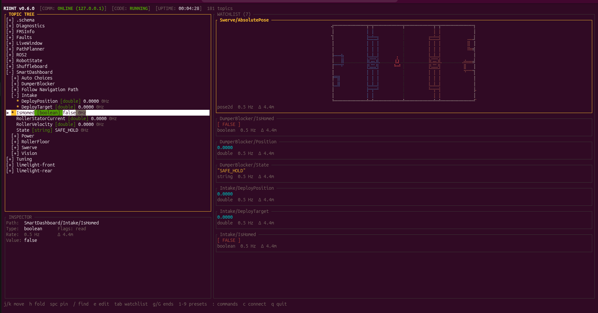
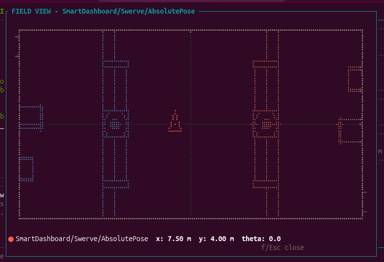
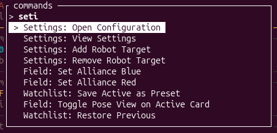

# RIoNT — Robot Inspection Over Network Tables

A keyboard-only NetworkTables (NT4) dashboard for FRC. Rust + ratatui. Pronounced "RINT"



## Features

- **Topic tree**
- **Inspector dock (`INSPECT`)**
- **Watchlist**
- **Field visualization**
- **Inline topic editing**
- **Command palette**
- **Topic presets**

## Installation

No Rust toolchain is needed to run RIONT.

### Quick install (recommended)

**Windows (PowerShell):**

```powershell
irm https://raw.githubusercontent.com/lukalyc/RIoNT/master/scripts/install.ps1 | iex
```

**macOS / Linux:**

```sh
curl -fsSL https://raw.githubusercontent.com/lukalyc/RIoNT/master/scripts/install.sh | sh
```

The installer downloads the latest release from [GitHub Releases](https://github.com/lukalyc/RIoNT/releases/latest), verifies its SHA256 checksum, installs `riont` (`%LOCALAPPDATA%\riont\bin` on Windows; `~/.local/bin` on macOS/Linux), and adds it to your `PATH` (no admin/sudo required).

Open a **new** terminal and verify:

```sh
riont --version
riont
```

### Manual install (from GitHub Releases)

Download the matching archive from [GitHub Releases](https://github.com/lukalyc/RIoNT/releases/latest):

- **Windows** (`riont-<version>-x86_64-pc-windows-msvc.zip`):
  1. Right-click the `.zip` file → **Extract All...**.
  2. Move `riont.exe` into `%LOCALAPPDATA%\riont\bin` (create the folder if needed).
  3. Press `Win`, search **Edit environment variables for your account**, select **Path** under *User variables* → **Edit** → **New**, and add `%LOCALAPPDATA%\riont\bin` → **OK**.
  4. Open a **new** terminal (Windows Terminal, PowerShell, or Command Prompt) and run `riont`.
- **macOS** (`riont-<version>-aarch64-apple-darwin.tar.gz` for Apple Silicon, or `riont-<version>-x86_64-apple-darwin.tar.gz` for Intel):
  ```sh
  tar -xzf ~/Downloads/riont-*-apple-darwin.tar.gz
  mkdir -p ~/.local/bin
  mv riont-*/riont ~/.local/bin/riont
  chmod +x ~/.local/bin/riont
  xattr -d com.apple.quarantine ~/.local/bin/riont 2>/dev/null || true
  grep -qF '$HOME/.local/bin' ~/.zshrc 2>/dev/null || echo 'export PATH="$HOME/.local/bin:$PATH"' >> ~/.zshrc
  ```
  Open a **new** Terminal window and run `riont`.
- **Linux** (`riont-<version>-x86_64-linux-gnu.tar.gz`):
  ```sh
  tar -xzf ~/Downloads/riont-*-x86_64-linux-gnu.tar.gz
  install -Dm755 riont-*/riont ~/.local/bin/riont
  ```
  If `~/.local/bin` is not already on your `PATH`, add `export PATH="$HOME/.local/bin:$PATH"` to `~/.bashrc` (or your shell profile), then open a **new** terminal and run `riont`.

### Update, uninstall & source builds

- **Update:** re-run the quick install command above.
- **Uninstall:** delete `%LOCALAPPDATA%\riont\bin\riont.exe` (Windows) or `~/.local/bin/riont` (macOS/Linux).
- **From source (requires Rust):** `cargo install --git https://github.com/lukalyc/RIoNT.git` (or see [CONTRIBUTING.md](CONTRIBUTING.md)).

## Keymap

| Key | Tree | Watchlist |
| --- | --- | --- |
| `j` `k` / up-down | move | move row |
| `h` `l` / left-right | toggle folder fold | move card |
| `g` / `G` | top / bottom | first / last card |
| `Space` | pin topic to watchlist (dir = whole subtree) | unpin active card |
| `x` | — | dismiss active card |
| `f` | — | enlarged field view (toggle) on a hovered field card |
| `v` | — | toggle pose card between field map and compact numeric card |
| `o` | — | overlay: merge field cards into one composite field |
| `e` / Enter | edit value (bool/int/double/string) | edit active card |
| `Tab` | → watchlist | → tree |
| `/` | fuzzy search; `Space` pins a match, `Enter` jumps to it | |
| `c` / `Shift+C` | connection picker | |
| `:` / `Ctrl-P` | command palette | |
| `1`-`9` | load workspace preset slot `1`–`9` | |
| `p` | focus top-right preset bar (`j`/`k` move, `Space` save/overwrite, `Enter` load, `r` rename, `x` clear, `Esc` back) | |
| `u` | restore previous watchlist (undo a preset load / clear) | same |
| `q` / `Ctrl-C` | quit | |

## Screenshots

Enlarged field view (`f` on a field card) — the robot's live pose over the
season map:



Command palette (`:`) — a fuzzy action runner over every command:



## Field visualization

A pinned topic whose value is a robot pose renders as a braille top-down
field with a live robot marker and a pose trail. The robot is drawn as a
rectangle footprint with a center orientation arrow (inside the frame);
the footprint size comes from `config.json` (`field.robot_length_m` /
`field.robot_width_m`, meters, defaults 0.9 × 0.9).

- **Auto-detected, conservatively:** only exact Limelight pose topics
  (`botpose`, `botpose_wpiblue`, `botpose_wpired`, `botpose_orb_*`, any
  camera prefix) and WPILib `struct:Pose2d` topics. Lookalikes — target
  poses, arbitrary `double[6]` arrays — stay ordinary value cards.
- **Manual toggle (`v` / palette):** press `v` on any hovered pose card (or
  inside the enlarged `f` field view) to collapse it into a compact
  numeric card — and press `v` again to expand it back. The palette command
  `Field: Toggle Pose View on Active Card` also collapses auto-detected pose
  cards or forces a field card on a lookalike topic (saved in
  `field.disable_pose_topics` / `field.force_pose_topics`).
- **Overlay groups:** `o` on a field card merges it with other overlaid
  field cards into ONE composite card — compare odometry against a vision
  estimate on a single field, with a per-topic legend. `o` again unmerges.
- **Alliance color** follows the exact `FMSInfo/IsRedAlliance` topic
  (neutral cyan if topic not found). Flipping the field geometry is done via
  user setting (`Field: Set Alliance Red/Blue`).

## Usage

```
riont 9986            # team number -> 10.99.86.2
riont 172.22.11.2     # direct IP (USB tether)
riont 127.0.0.1:5810  # explicit host:port (e.g. robot simulation)
riont                 # last successfully connected target, else 172.22.11.2
```

Connects on TCP 5810 (NT4 WebSocket) and auto-reconnects forever. The last
successfully connected target is remembered and reused by a bare `riont`
launch. Retarget mid-session with `c`.

## Settings & persistence

Everything lives in `~/.config/riont/config.json` (override the path with
the `RIONT_CONFIG` environment variable):

```json
{
  "last_target": "10.1.18.2",
  "saved_targets": [
    {"name": "Simulation", "ip": "127.0.0.1:5810"},
    {"name": "USB Tether", "ip": "172.22.11.2"},
    {"name": "Team 118",   "ip": "10.1.18.2"}
  ],
  "preset_slots": {
    "1": {"name": "swerve", "topics": ["Swerve/*", "SmartDashboard/Battery Voltage"]},
    "2": {"name": "vision", "topics": ["limelight-front/*"]}
  },
  "system": {
    "ssh_user": "admin",
    "restart_cmd": "/usr/local/frc/bin/frcRunRobot.sh restart"
  }
}
```

Presets are saved in numbered slots (`1`–`9`) via the top-right preset bar
(`p`, then `j`/`k` and `Space`) or the palette (`Watchlist: Save Active as
Preset`), and load with `1`–`9`. Legacy name-keyed `"presets"` entries remain
supported and migrate automatically when saved. Commit `config.json` to your
team repo so everyone gets the same views. The live watchlist persists to
`last_view` after every change and is restored on the next launch.

## Development & releases

- **Tests:** `cargo test --workspace` (in-process) and
  `python test/harness.py` (end-to-end contract harness).
- **Changelog:** user-visible changes add a bullet under `## [Unreleased]`
  in `CHANGELOG.md` in the same commit. Versions move only at release time.
- **Cutting a release:** `scripts/release.sh <patch|minor|major> "summary"`,
  then `git push --follow-tags` — CI builds and attaches Windows/Linux/
  macOS binaries to the GitHub release.

See [CONTRIBUTING.md](CONTRIBUTING.md) for building from source, the code
layout, the NT4 protocol notes and the full testing/release walkthrough.

## Contributing

Contributions are welcome — bug reports with screenshots (the HUD version
identifies your exact release) and focused PRs. Read
[CONTRIBUTING.md](CONTRIBUTING.md) first; `ROADMAP.md` records what RIONT
is, what it deliberately is not, and what's worth building next.
